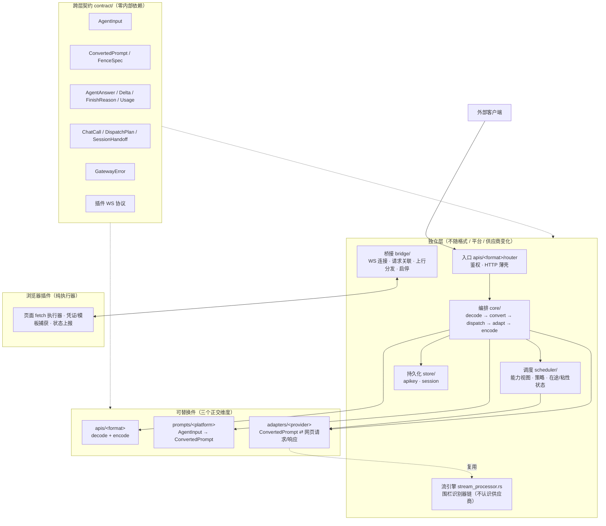
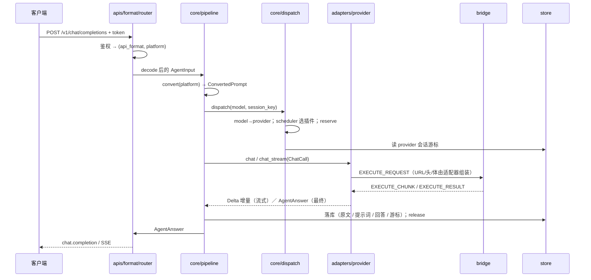
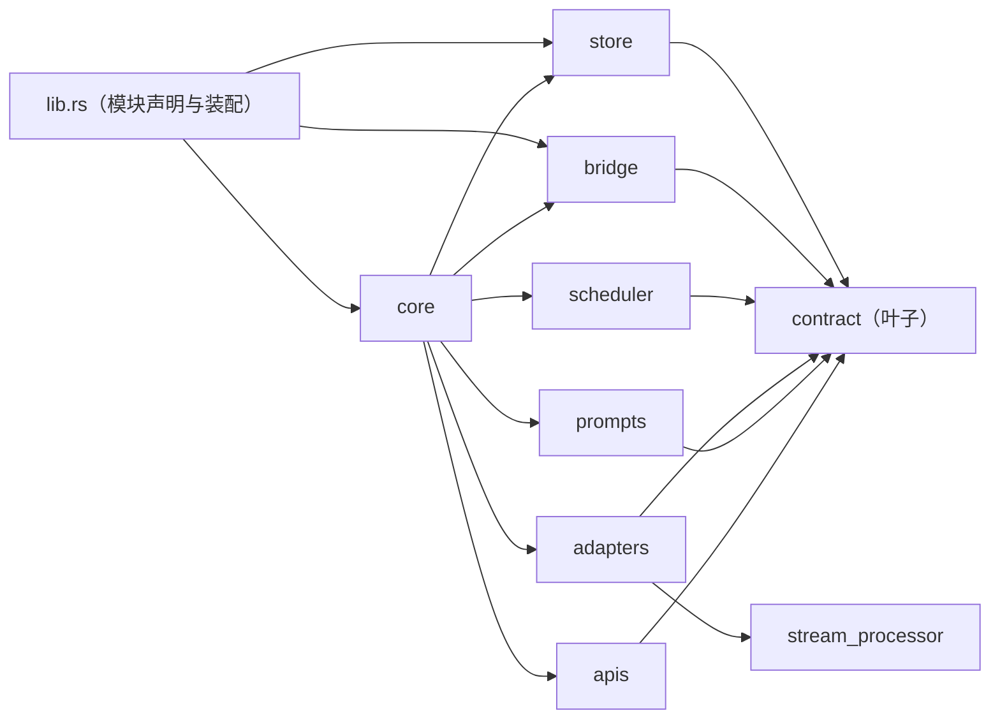

# Poolman 架构重设计

> **本文是目标架构的唯一权威定义，自包含**：只读本文即可知道「从哪里来、要到哪里去、怎么过去」。
> [`链路设计.md`](./链路设计.md) 保留为「链路视角」补充（7 步链路、两个分派点、端到端时序）；两者不冲突时互补，冲突处以本文为准。
>
> 本文只做设计，不含实现代码。现状描述基于工作区实测（`cargo check`、`git status`）。

---

## 0. 结论速览

| 项 | 结论 |
|---|---|
| 现状 | 一次**未完成的大重构**：三代设计同时留在编译单元里，`cargo check` 报 6 个错，且模块解析失败掩盖了更多下游错误 |
| 根因 | 先搬目录、后定契约归属与编排层，于是旧代没删、新代没接线，边界继续互相穿透 |
| 目标 | **三正交维度**（API 格式 / 接入平台 / 网页供应商）× **一个编排管线**（`core/`）× **一个跨层契约包**（`contract/`） |
| 入口 | 同一入口同时兼容 **OpenAI Chat Completions / OpenAI Responses / Anthropic Messages / Gemini generateContent** 四种公共接口，**按路径分派**格式，共用一条管线（§4） |
| 路线 | 7 个阶段，每阶段 `cargo check` + 单测全绿、行为不变，可随时中断 |
| 最大的三处结构性问题 | ① 适配器认识 OpenAI 形状并自己调平台转换器；② 流式增量是「字符串里的 JSON」；③ 插件选择/流控/粘性这类业务决策住在 WebSocket 收发层 |

---

## 1. 系统定位与不变量

### 1.1 是什么

本地网关：复用浏览器里**已登录的 AI 网页会话**（DeepSeek / ChatGPT / Claude / Gemini / Kimi / 通义千问），对外提供**多家公共 API 格式的兼容入口**（OpenAI Chat Completions、OpenAI Responses、Anthropic Messages、Gemini generateContent）。零 API Key、零云端依赖、全部本地。

「兼容多家格式」只是**入口层**的能力：客户端只改 baseURL、不换 SDK。它不改变内部链路——所有格式在入口处即被归一化为同一条管线（§4）。

### 1.2 三段式

```
外部客户端（OpenAI 兼容 SDK / Cursor / Chatbox）
        │  HTTP / SSE        http://127.0.0.1:13213
        ▼
桌面端 Tauri 应用（Rust）—— **全部业务逻辑在这里**
        │  WebSocket          ws://127.0.0.1:3001
        ▼
Chrome 插件—— **纯执行器**：在已登录页面里代发一次 fetch，把原始响应回传
        │  chrome.scripting (MAIN world)
        ▼
AI 网页（用户已登录的会话）
```

插件已退化为连接器：它不组装请求、不解析响应、不做业务判断。业务（凭证、PoW、签名、SSE 分行、422 自愈、工具调用解析、token 估算）**全部在桌面端**。

### 1.3 设计不变量（后续所有决定都必须守住）

| # | 不变量 | 违反的表现 |
|---|---|---|
| I1 | 业务逻辑只在桌面端；插件不含业务语义 | 插件里出现提示词拼装 / 模型映射 / 工具解析 |
| I2 | 网页供应商的私有细节（PoW / 凭证 / 签名 / 会话链 / SSE 行解析 / 422 自愈 / usage 估算 / 工具解析）永不上浮 | 上层代码里出现 `x-ds-pow-response`、`chat_session_id` 之类字样 |
| I3 | 三个可替换维度（API 格式 / 接入平台 / 网页供应商）**互不引用** | 适配器里出现 `if platform == "vscode-copilot"` |
| I4 | 跨层只传契约类型，不传 `serde_json::Value` 自由字段 | `options["sessionId"]`、`options["converterPlatform"]` 这类字符串键 |
| I5 | 合规：仅供学习研究，文档与界面明示自动化操作网页版的风险 | —— |

---

## 2. 现状诊断

### 2.1 一句话

同一份代码里同时住着**三代设计**：旧代（`models::Model` 抽象）没删、中间代（巨石适配器 + 就近契约）在用、目标代（契约包 + 编排层 + 拆分适配器）写了一半没接线，因此模块解析就失败。

### 2.2 编译现状（实测 `cargo check`）

`cargo check` / `cargo build` **0 error**（`desktop.exe` 可产出，`pnpm tauri dev` 可跑）。

历史阻塞点已清：`mod converter;` / `mod openai;` 的模块声明已修正，旧适配器树（`extension/adapters.rs` 的
巨石 `deepseek.rs` 与拆分版 `deepseek/`）**已删除**，它下面那 5 个迁移中间态错误（`pow` 未声明、
`crate::converter::*` 不存在、`ExecuteRequestPayload` 缺 `session_key`）随之消失。
运行期链路不经过该树：网页渠道由 `models/` 直接实现，请求经 `extension/executor.rs` 下发。

`cargo test`：**82 passed / 1 failed**。唯一失败是 `stream_processor::tests::auto_md_longer_fence`
（4 反引号长围栏的闭合判定），与本轮改动无关，属该引擎自身的既有问题。

### 2.3 三代并存清单

| # | 代 | 内容 | 位置 | 状态 |
|---|---|---|---|---|
| 1 | 旧 | `Model` / `ModelStatus` / `ModelManager`（共 3 个空壳） | `models/{model.rs,defs.rs,manager.rs}` | 已被重建为统一模型抽象（见 #15），旧空壳已移除 |
| 2 | 旧 | `AppState` + `health_handler` + `models_handler` | `apis/base.rs` | 与 `apis/openai/api.rs` 重复；自身缺 import、引用 `models::manager`，从未被声明编译 |
| 3 | 旧 | 8 个文件时代的模块声明 | `lib.rs` 顶部 | `mod converter;` `mod openai;` 指向已删/已搬走的文件 |
| 4 | 旧 | **巨石适配器** 2860 行 | `extension/adapters/deepseek.rs` | **已不在运行期链路上**（`models/` 取代它），且处于迁移中间态无法编译，故暂不参与构建；搬迁完成后删除 |
| 5 | 中 | `ParseWebService` / `ChatWebService` / `BaseWebService` / `SessionWebService` 四 trait | `extension/adapters/defs.rs` | 同上，暂不参与构建；入参形状违反 I3/I4 |
| 6 | 新 | 拆分版适配器 7 文件 | `extension/adapters/deepseek/{service,chat_service,web_service,defs,streaming,tool_parsing,pow}.rs` | **未接线**：`deepseek/` 无 `mod.rs`，`extension/adapters.rs` 声明的是同名巨石文件；随整棵适配器树暂不参与构建 |
| 7 | 新 | `ProviderAdapter` 门面 + 适配器注册表 | `extension/adapters/defs.rs` | 门面已定义，但注册表版装配未接线；随适配器树暂不参与构建 |
| 8 | 新 | 契约与转换层 | `agent/input.rs`、`converters/api/*`、`prompts.rs` + `prompts/*` | 已接线（`lib.rs` 声明 `mod agent;` / `mod converters;` / `mod prompts;`）；因旧适配器树暂不参与构建，暂报 `never used`，待链路调用后消除 |
| 9 | 新 | OpenAI 薄层 | `apis/openai/{api.rs,chat_router.rs}` | 未接线：`apis/openai.rs` 只声明了 `chat_completions` / `completions` / `responses` |
| 10 | 残留 | 空模块 | `extension/entitys.rs`（0 行）、`apis/openai/{completions.rs,responses.rs}`（各 1 行）、`apis/openai/chat_completions.rs`（1 行） | 搬迁痕迹 |
| 11 | 已就位 | 通用流式围栏引擎 657 行 | `stream_processor.rs` | 已在 `lib.rs` 声明；**与供应商/平台无关**，是目标架构里的正确构件 |
| 12 | 已就位 | 调度纯函数 | `extension/scheduler.rs` | 算法与单测齐备，但**只是被 `websocket.rs` 调用的纯函数**，状态（inflight/sticky）留在桥接层 |
| 13 | 新 | 插件实例管理器 | `extension/manager.rs` | 登记插件身份与连接信息并持久化到 `plugins.json`；插件状态/启用选择的唯一归属，`websocket.rs` 只做连接通道 |
| 14 | 新 | 供应商抽象与持久化 | `providers/`（`providers.rs` 入口与注册表 + `defs.rs` 公共定义 + `plugin.rs` 插件供应商 + `entity.rs`/`manager.rs` 供应商与模型的 sea-orm 持久化与 `ProviderManager`） | 把浏览器插件连接建模为供应商 `plugin`（对外模型清单 = 别名→渠道），对外统一 chat_completions 接口；供应商与模型定义/启停/状态落库（取代内存索引与 JSON 启停文件）；插件实例由管理器调度，供应商不感知实例 |
| 16 | 新 | 模型路由 | `chat_router.rs`（crate 根） | `ChatRouter`——与 API 格式、供应商实现都解耦的编排入口；按**请求参数 + 调用方 token** 选择模型：token 校验 → 解析（模型名/别名→渠道）→ 存在性 → 渠道启停 → 能力（流式/工具）；各格式共用，渠道会话访问也经由它 |
| 15 | 新 | 统一模型抽象 | `models/`（`defs.rs` 公共定义与渠道执行契约 + `model.rs` 抽象 trait + `plugin.rs` 插件模型 trait + `pow.rs` PoW + `deepseek_web.rs` DeepSeek 网页模型） | 模型是执行对话的最小单元：**并发是模型基础属性**（`Concurrency{max_inflight, per_session_serial}`）；插件模型（`PluginModel`）对应一个 web 渠道并**自行实现渠道会话管理**（不注入外部服务）；DeepSeek 网页模型不导入适配器模块的类，自带所需实现；提示词/平台转换/插件实例选择都不属于模型 |

### 2.4 边界穿透清单（违反 I2/I3/I4 的具体位置）

| # | 穿透 | 位置 | 违反 |
|---|---|---|---|
| P1 | 适配器收 OpenAI 形状 `messages: Vec<Value>` + `options: Value`，**自己判断 `is_first_turn`、自己从 messages 里 `extract_session_id_from_history`**，并调用平台转换器 `build_prompt(..., platform)` | `extension/adapters/deepseek.rs`（拆分版同形：`deepseek/chat_service.rs::build_request`） | I3：③ 在 ⑤ 内部执行 |
| P2 | `ParseWebService::build_prompt(messages, tools, is_first_turn, platform)` 把 **`platform` 交给适配器** | `extension/adapters/defs.rs` | I3 |
| P3 | `ChatWebService::chat(messages, options)` —— 适配器认识 API 形状 | `extension/adapters/defs.rs` | I3 |
| P4 | 流式增量是**字符串里的 JSON**：`{"THINK":…}` / `{"RESPONSE":…}` / `{"tool_calls":[…]}`，编码层必须 `serde_json::from_str` 猜 | 生产 `deepseek/streaming.rs`、消费 `apis/openai/api.rs::chat_completions_handler` | I4 |
| P5 | 业务契约 `ChatResponsePayload` 定义在**传输层** | `extension/websocket.rs` | I4 |
| P6 | **桥接层做业务决策**：选插件、并发上限、粘性、拒绝文案全在 `send_execute` 里 | `extension/websocket.rs`（`MAX_INFLIGHT_PER_PLUGIN` / `sticky_sessions` / `inflight`） | I1/I3 的灰区 |
| P7 | `/v1/models` 写死一份 7 条列表，且与 `ModelMapping`（15 条）不一致 | `apis/openai/api.rs::models_handler`（`apis/base.rs` 同形） | I4 |
| P8 | 会话 id / 平台 / 工具 靠 `options` 的自由字段传递（`sessionId` / `converterPlatform` / `tools` / `apiKey`） | `apis/openai/api.rs` → 适配器 | I4 |

### 2.5 契约缺位清单

| # | 缺什么 | 现在的替补 |
|---|---|---|
| C1 | `ConvertedPrompt`（③ → ⑤ 的入参类型） | 裸 `String` |
| C2 | 类型化 `Delta`（⑤ → ⑦ 的增量） | JSON 字符串（P4） |
| C3 | `AgentAnswer`（⑤ → ⑦ 的出参类型） | `ChatResponsePayload`，缺 `reasoning` / `diagnostics` |
| C4 | `GatewayError`（分层错误） | 全链路 `anyhow`，编码层无法分档成 HTTP 状态码 / SSE error 事件 |
| C5 | **供应商网页会话状态**的归属与持久化 | 适配器用内存 `Mutex<Option<String>>` + `Mutex<HashMap<String,i64>>` 持有网页会话 id 与游标，**进程重启即丢**，也没和网关会话绑定 |
| C6 | 插件协议两侧对称 | Rust `ExecuteRequestPayload` 有 `session_key`，TS 侧 `ExecuteRequestPayload`（`packages/shared/src/types/protocol.ts`）没有 |
| C7 | **历史里 assistant 的工具调用原文被丢弃** | `converters/api/openai.rs::to_agent_input` 用 `content_text()` 只取正文，不读 `tool_calls` → 多轮工具调用的历史在提示词里只剩空 assistant 回合 |
| C8 | **工具定义形状被写死成 OpenAI** | `AgentInput.tools: Option<Value>` 把入站 JSON 原样透传给 `Converter::convert_tools`；接入第二种格式时 `prompts/` 会不认识 |

> C5 是当前最容易被忽略的一条：会话粘性键是「网页会话 id」，而网页会话 id 本身只活在内存里；一旦重启，粘性失效、会话链断裂。

### 2.6 根因

`链路设计.md` 定义了「层」，但没有定义落地必需的另外两件事：

1. **跨层契约类型住在哪** → 于是 `ChatResponsePayload` 就近塞进 `websocket.rs`，`Delta` 留在字符串里，`ConvertedPrompt` 干脆没出现。
2. **编排逻辑归谁** → 于是「选插件 / 判启用 / 算首轮 / 调平台转换器」四散在 `ChatRouter`、适配器、`send_execute` 三处，而 `ChatRouter` 还住在「OpenAI 格式」目录下。

缺了这两条，「搬目录」就变成了看起来在分层、实际边界互相穿透的半成品。

---

## 3. 目标架构

### 3.1 总览



### 3.2 三个正交维度

链路上只有三个**真正可替换**的维度，必须严格正交、互不知晓：

| 维度 | 取值（现状） | 决定 | 住在 |
|---|---|---|---|
| **API 格式** | `openai-chat` / `openai-responses` / `anthropic-messages` / `gemini` | ② 解析入站请求、⑦ 编码出站响应 | `apis/<format>/` |
| **接入平台** | `vscode-copilot` / `trae_work` | ③ 组装 poolman 提示词 | `prompts/<platform>.rs` |
| **网页供应商** | `deepseek-web`（插件侧另有 5 个未接后端） | ⑤⑥ 网页请求组装与响应解析 | `adapters/<provider>/` |

**怎么落到具体实现**（两个分派点）：

- **① 入口按路径分派格式、按 API Key 分派平台**：路径 → API 格式（§4.1）；`store::apikey::resolve(key) → platform`。两者正交——同一接入平台可以用任一种格式调用，同一格式也可以来自任一平台。
- **④ 编排按模型名分派供应商**：`ModelMapping[model] → provider`，再按插件能力选定插件连接。

三者之间**没有任何引用关系**：适配器不知道 `platform`；转换器不知道 `provider`；编码器不知道供应商。

### 3.3 层职责与「明确不做」

| 层 | 做什么 | 明确不做 |
|---|---|---|
| `apis/<format>/router` | 校验 token；确定 `(api_format, platform)`；把请求交给 `core`；把结果编码回该格式 | 不解析业务参数、不转提示词、不知道供应商 |
| `core/pipeline` | 按序驱动五步；串起流式/非流式两条路径 | 不解析格式、不拼提示词、不做网页协议 |
| `core/dispatch` | `model → provider`；调 `scheduler` 选插件；reserve/release 在途 | 不组装请求 |
| `core/session` | 落库（入站原文 / ConvertedPrompt / AgentAnswer / provider 会话游标）；维护会话粘性键 | 不参与转发 |
| `scheduler` | 能力视图、过滤/排序策略、在途计数、会话粘性、重试判定 | 不认识提示词与响应 |
| `prompts/<platform>` | `AgentInput → ConvertedPrompt`（人设 + 平台规则段 + 工具段 + 用户段） | 不发请求、不知道插件与供应商 |
| `adapters/<provider>` | 下行：`ConvertedPrompt` + 元信息 → 网页请求；上行：网页原文 → `AgentAnswer` | 不知道 `platform`、不知道 API 格式、不碰 DB |
| `bridge` | WS 连接管理、`id → oneshot/增量回调` 关联、下行下发、上行分发、启停指令 | **不做业务决策**（选插件/拼提示词/判模型都不在） |
| `store` | API Key、会话三表、供应商启用开关、provider 会话游标 | 不参与转发 |
| `stream_processor` | 通用围栏流式切分（识别器链 + 嵌套围栏 + 强制闭合） | 不认识任何供应商、不产出业务语义 |
| 插件 | 收 `EXECUTE_REQUEST` → 页面 fetch → 回传原始流；捕获凭证/接口模板；周期上报状态 | 不解析业务语义、不做模型映射 |

### 3.4 跨层契约 `contract/`（新建）

横切所有层的东西只能有「契约类型」：集中、中性、**不依赖任何内部模块**。

| 契约 | 方向 | 内容 | 现状 |
|---|---|---|---|
| `AgentInput` | ② ↔ ③ | `system_prompt` / `history` / `question` / `tool_results` / `tools: Vec<ToolDef>` / `params` | 已有 `agent/input.rs`，**移动**；`tools` 需从 `Value` 收敛、`Turn` 需补 `tool_calls`（解 C7/C8） |
| `ToolDef` / `ToolChoice` | ② ↔ ③ | `{ name, description, parameters, strict }` / `Auto / None / Required / Named(..)` | **待建**：各格式解码器把自家工具形状归一到这里（§4.3） |
| `ConvertedPrompt` | ③ ↔ ⑤ | `prompt: String` + `is_first_turn` + `fence: FenceSpec` + `tool_schema_hash` | **待建**（现在只有裸 `String`） |
| `AgentAnswer` | ⑤ ↔ ⑦ | `content` / `reasoning` / `tool_calls` / `finish_reason` / `usage` / `diagnostics` / `session: SessionOutcome` | 演进自 `ChatResponsePayload`，**搬家并补齐** |
| `Delta` | ⑤ → ⑦ | `enum Delta { Reasoning(String), Content(String), ToolCalls(Vec<ToolCall>) }` | **待建**（现在是字符串里的 JSON） |
| `ChatCall` | ④ → ⑤ | `prompt` + `model` + `params` + `session: SessionHandoff` | **待建** |
| `DispatchPlan` | ③ → ④ | `provider` + `model` + `session_key` | **待建**（现在散在 `options` 里） |
| `GatewayError` | 全层 | `Unauthorized` / `ProviderDisabled` / `NoPluginAvailable` / `Timeout` / `Upstream{status,body}` / `Protocol` / `Internal` | **待建**（现在全是 `anyhow`） |
| 插件 WS 协议 | 桥接 ↔ 插件 | `ExecuteRequest` / `Chunk` / `Result` / `Error` / `CredentialSync` / `StatusSync` / `ProviderControl` | 已有，从 `websocket.rs` 与 TS 侧**合并同源** |

两条要点：

- **`Delta` 把类型语义从「字符串里的 JSON」提升为类型**，编码层不再 `serde_json::from_str` 猜测（解 P4）。
- **`SessionHandoff` / `SessionOutcome` 显式化供应商会话状态**：`core` 只做不透明存取，语义归适配器（解 C5）。

```text
SessionHandoff { gateway_session_id, web_session_hint: Option<String>, cursor: Option<Value> }
SessionOutcome { web_session_id: Option<String>, cursor: Option<Value> }
```

`cursor` 是供应商私有游标（DeepSeek 的 `parent_message_id` 之类）：**适配器定义与解释，`core` 只负责按 `(gateway_session, provider)` 存取**，上层永不解读。

### 3.5 编排管线 `core/`

抽出与 API 格式 / 平台 / 供应商都无关的**唯一编排管线**：

```text
decode(api_format) → convert(platform) → dispatch(model → provider → plugin) → adapt(provider) → encode(api_format)
```



`apis/<format>` 只剩 **HTTP 薄路由 + decode + encode**；接第二个 API 格式不需要复制编排。

### 3.6 适配器边界（最需要守的地方）

只保留一个门面 trait：

```text
pub trait ProviderAdapter: Send + Sync {
    fn id(&self) -> &'static str;

    // 非流式
    fn chat(&self, call: ChatCall) -> BoxFuture<Result<AgentAnswer>>;

    // 流式：增量经 sink 实时送出（类型化 Delta）
    fn chat_stream(&self, call: ChatCall, sink: DeltaSink) -> BoxFuture<Result<AgentAnswer>>;

    // 可选：网页会话管理（列表 / 删除）
    fn sessions(&self) -> Option<&dyn ProviderSession>;
}

pub type DeltaSink = Box<dyn FnMut(Delta) + Send + Sync + 'static>;
```

**必须删除**：

- `ParseWebService` —— 它把 `platform` 塞进适配器，是 P1/P2 的直接来源；
- `ChatWebService::chat(messages, options)` —— 适配器不该认识 API 形状（P3）。

**保留但下沉为适配器内部服务**：

- HTTP 执行（现 `BaseWebService` 的 `execute_once` / `execute_streaming`）：只是「经桥接发一次网页请求」，不应暴露成对外 trait；
- 网页会话（现 `SessionWebService`）：只给有会话概念的供应商。

**纯内部、永不上浮**：SSE 行解析、围栏识别、工具调用解析（含 DSML）、422 自愈、PoW、凭证、签名、usage 估算、重试。这些换个供应商就不成立。

**复用共享引擎**：通用围栏切分用 `stream_processor.rs`（由适配器提供 `FenceRecognizer` 实现，围栏标签取自 `contract::FenceSpec`），不各自重写。

### 3.7 目标目录

```text
src/
  contract/            新建：零内部依赖的契约类型
    agent_input.rs         AgentInput / Turn / Params
    prompt.rs              ConvertedPrompt / FenceSpec
    answer.rs              AgentAnswer / Delta / FinishReason / Usage / Diagnostics
    call.rs                ChatCall / SessionHandoff / SessionOutcome / DispatchPlan
    protocol.rs            插件 WS 协议（Rust 侧唯一表达，与 TS 同源）
    error.rs               GatewayError
  apis/                合并 现 apis/ + converters/api/
    mod.rs                 路径 → ApiFormat 分派 + 共享装配（CORS / 健康检查 / 模型清单）
    openai/chat.rs         decode + encode + 路由（首个落地格式）
    openai/responses.rs
    anthropic/messages.rs
    gemini/generate.rs
  prompts.rs           提示词工程入口：Converter trait + 组装顺序 + POOLMAN_OWNED_TAGS + 平台解析
  prompts/
    system.md              poolman 系统段正文（唯一来源，编译期嵌入）
    poolman.rs             system_prompt / 围栏规格 / 共享辅助
    vscode_copilot.rs  trae_work.rs   各接入平台的工具段/系统段/用户段转换
  core/                新建：编排
    pipeline.rs            五步管线（流式 / 非流式）
    dispatch.rs            model → provider → plugin
    session.rs             落库 + 会话粘性 + provider 游标存取
  scheduler/           现 extension/scheduler.rs 升格为目录
    capability.rs          能力视图（插件 × 供应商 × 模型 × 在途）
    policy.rs              过滤 / 排序（纯函数，保留现有单测）
    state.rs               在途计数 / 粘性 / last_ok，reserve / release
  adapters/            现 extension/adapters/
    mod.rs                 注册表：provider id → Arc<dyn ProviderAdapter>
    defs.rs                ProviderAdapter 门面 + 内部 HTTP / 会话服务
    deepseek/{service,chat_service,web_service,defs,pow,streaming,tool_parsing}.rs
    dsml.rs                DSML 标记解析（适配器内部）
  bridge/              现 extension/{websocket,handler,credentials,provider_control}
    ws.rs  upstream.rs  control.rs  credentials.rs  status.rs
  store/               现 apikey.rs + session/ + provider_control 的持久化面
    apikey.rs  session.rs  entity/
  stream_processor.rs  保留原位：通用引擎（不认识供应商）
  commands.rs           Tauri 命令面入口：汇总各业务域的命令组
  commands/             按业务域分文件，各自用 command_set! 声明本域命令
  handlers.rs           命令组组合层：CommandSet / command_set! / chain_commands!
  config.rs             运行配置
  lib.rs                模块声明 + 启动装配（pub fn run()）
  main.rs               二进制入口（调用 desktop_lib::run()）
```

对应关系速查：

| 目标 | 来源 |
|---|---|
| `contract/` | `agent/input.rs` + `extension/websocket.rs` 的契约类型 + 新建 `ConvertedPrompt`/`Delta`/`ChatCall`/`GatewayError` |
| `apis/` | `apis/openai/` + `converters/api/`（两个「api」目录合并；扩展为四格式入口，见 §4） |
| `prompts.rs` + `prompts/` | `converters/prompt/` + `agent/poolman.rs` + `agent/prompts/`（已就位，位于 crate 根） |
| `core/` | 新建（把 `ChatRouter` 的编排、`send_execute` 的政策上提） |
| `scheduler/` | `extension/scheduler.rs`（算法不变，加状态） |
| `adapters/` | `extension/adapters/`（**接线拆分版，删巨石 `deepseek.rs`**） |
| `bridge/` | `extension/{websocket,handler,credentials,provider_control}` |
| `store/` | `apikey.rs` + `session/` |
| **删除** | `extension/entitys.rs`、`apis/base.rs`、空 `completions.rs`/`responses.rs`/`chat_completions.rs`、`lib.rs` 的 `mod converter;`/`mod openai;` |

### 3.8 依赖规则



硬规则（用契约测试守，见 §7）：

1. `contract/` **不依赖任何其它内部模块**。
2. `apis/` 与 `prompts/` **互不引用**。
3. `adapters/` **不得引用** `apis` / `prompts` / `core` / `store`。
4. `bridge/` 只收发协议，**不做业务决策**；不得引用 `prompts` / `adapters` / `apis`。
5. `stream_processor` 不认识任何供应商 / 平台 / 格式，只认 `FenceRecognizer`。

---

## 4. 入口 API 面（多格式支持）

> **目标：客户端只改 baseURL，不换 SDK。**
> 同一进程同时暴露多家公共接口，全部落到同一条 `core` 管线。格式差异**只能**存在于 ② 与 ⑦。

### 4.1 路由矩阵

| 方法 | 路径 | API 格式 | 流式判定 |
|---|---|---|---|
| POST | `/v1/chat/completions` | `openai-chat` | body `stream: true` |
| POST | `/v1/responses` | `openai-responses` | body `stream: true` |
| POST | `/v1/messages` | `anthropic-messages` | body `stream: true` |
| POST | `/v1beta/models/{model}:generateContent` | `gemini` | —— |
| POST | `/v1beta/models/{model}:streamGenerateContent` | `gemini` | 路径 + `?alt=sse` |
| GET | `/v1/models` | OpenAI 与 Anthropic 共用 | —— |
| GET | `/v1beta/models` | `gemini` | —— |
| GET | `/health` | —— | —— |

- **路径是唯一分派依据**：不引入额外的「格式」配置项，客户端怎么调就怎么解析（这就是 §9-O2 的答案）。
- `/v1/models` 被 OpenAI 与 Anthropic 客户端共同探测，返回**两者字段的并集**（`id` / `object` / `created` / `owned_by` + `display_name`），互不干扰。
- 模型清单统一由 `packages/shared/src/types/models.ts::ModelMapping` 派生，不再写死（解 P7）。
- 可选扩展位（按需再接）：`POST /api/chat`（Ollama NDJSON）。嵌入类接口（`/v1/embeddings`）当前链路不具备能力，**应明确拒绝，而不是返回空向量**。

### 4.2 四种格式的差异要点

| 维度 | OpenAI Chat | OpenAI Responses | Anthropic Messages | Gemini generateContent |
|---|---|---|---|---|
| 鉴权 | `Authorization: Bearer`（另容 `x-api-key` / `api-key`） | 同左 | `x-api-key`（+ `anthropic-version`） | `x-goog-api-key` 或 `?key=` |
| 模型位置 | body `model` | body `model` | body `model` | **路径** `/v1beta/models/{model}`（需剥 `models/` 前缀） |
| 系统提示 | `messages[role=system]` | 顶层 `instructions` | 顶层 `system`（字符串或 block 数组） | 顶层 `systemInstruction.parts[]` |
| 角色命名 | `user` / `assistant` / `tool` | `input` 项数组 | `user` / `assistant` | `user` / **`model`** |
| 工具声明 | `tools[{type:"function",function:{name,description,parameters}}]` | `tools[{type:"function",name,description,parameters}]`（**扁平**） | `tools[{name,description,input_schema}]` | `tools[{functionDeclarations:[…]}]` |
| 工具调用回传 | `message.tool_calls[{id,type,function:{name,arguments}}]`，arguments 是 **JSON 字符串** | `output[{type:"function_call",name,arguments,call_id}]` | `content[{type:"tool_use",id,name,input}]`，input 是 **对象** | `parts[{functionCall:{name,args}}]`，args 是 **对象** |
| 工具结果 | `role:tool` + `tool_call_id` | `function_call_output` 项 | `tool_result` block（需配对的 `tool_use` 在前） | `functionResponse` part |
| 长度参数 | `max_tokens` / `max_completion_tokens`，可选 | `max_output_tokens`，可选 | **必填** `max_tokens` | `generationConfig.maxOutputTokens`，可选 |
| 结束原因 | `finish_reason`：`stop` / `tool_calls` / `length` | `status` + 输出项类型 | `stop_reason`：`end_turn` / `tool_use` / `max_tokens` | `finishReason`：`STOP` / `MAX_TOKENS` / … |
| 用量字段 | `prompt_tokens` / `completion_tokens` / `total_tokens` | `input_tokens` / `output_tokens` | `input_tokens` / `output_tokens` | `promptTokenCount` / `candidatesTokenCount` |
| 错误体 | `{error:{message,type,param,code}}` | `{error:{message,type,code}}` | `{type:"error",error:{type,message}}` | `{error:{code,message,status}}` |

> 差异全部止步于 ② 与 ⑦。`prompts/`、`adapters/`、`bridge/`、`core/` 看不到任何格式差异。

### 4.3 解码：四者归一到 `AgentInput`（对契约的要求）

| 入站差异 | 归一化动作 |
|---|---|
| 系统提示的四种位置 | 全部写入 `AgentInput.system_prompt` |
| 角色命名（`model` vs `assistant`） | 统一为 `assistant` |
| 工具定义的四种形状 | 统一为 `ToolDef { name, description, parameters, strict }`（**解 C8**） |
| 工具调用的两种参数形态（JSON 字符串 / 对象） | 统一为对象 |
| 工具结果的三种承载 | 统一为 `AgentInput.tool_results: Vec<Turn>`（`tool_call_id` 必填） |
| 多模态 `content`（数组 / `parts` / block） | 只取文本（现状策略），非文本项丢弃并记入 `diagnostics` |
| 模型的 `models/` 前缀、`?alt=sse` | 在路由层剥离，不进契约 |

**两处契约必须补强**，否则第二种格式一接就露馅：

1. **`Turn` 补 `tool_calls`**：现状 `Turn` 只有文本，assistant 的 `tool_calls` 在解码时被 `content_text()` 丢掉（C7）→ `Turn { role, content, tool_calls: Option<Vec<ToolCall>>, tool_call_id }`。
2. **`tools` 从 `Value` 收敛为 `Vec<ToolDef>`**（C8），`tool_choice` 收敛为 `ToolChoice`。否则 `prompts/<platform>::convert_tools` 必须认识四种格式——那正是本轮要避免的。

### 4.4 编码：编码器必须是**有状态**的

四种格式的流式协议差异太大，纯函数编码不出来：

| 格式 | 流式形态 |
|---|---|
| OpenAI Chat | 扁平 `choices[].delta`，`data:` 行，以 `data: [DONE]` 收尾 |
| OpenAI Responses | **具名事件**（`response.output_text.delta` / `response.function_call_arguments.delta` / `response.completed`） |
| Anthropic | **具名事件 + 块索引**：`message_start` → `content_block_start` → `content_block_delta` → `content_block_stop` → `message_delta` → `message_stop`；工具参数以 `input_json_delta` **分片**下发 |
| Gemini | **累积快照**：每个 chunk 给的是「到目前的 parts」，不是增量 |

因此 ⑦ 的接口是**每请求一个编码器实例**：

```text
trait ResponseEncoder {
    fn start(&mut self) -> Vec<Frame>;                    // 开场：Anthropic message_start / Responses response.created
    fn delta(&mut self, d: &Delta) -> Vec<Frame>;         // 增量
    fn finish(&mut self, a: &AgentAnswer) -> Vec<Frame>;  // 收尾：stop_reason / usage / [DONE] / message_stop
    fn error(&mut self, e: &GatewayError) -> Vec<Frame>;  // 中途出错
}

struct Frame { event: Option<&'static str>, data: String }  // event = None 表示只输出 data 行
```

三条约束：

- **`Frame` 必须能表达具名事件**，否则 Anthropic / Responses 实现不出来。
- **Gemini 的累积语义在编码器内部消化**：编码器自己记住已发出的文本长度，只发新增部分；`Delta` 保持增量语义，不为此回退。
- **工具参数分片**：OpenAI Chat（`index` + `arguments` 片段）、Anthropic（`input_json_delta`）、Responses 都是「先声明调用、再分片送参数」。因此 `AgentAnswer.tool_calls` 必须是**完整**的，由编码器决定一次性给出还是分片展开。

非流式则是纯函数：`encode(api_format, &AgentAnswer) -> JSON`。

### 4.5 错误与鉴权

- **鉴权**：每种格式只认自己的头（§4.2 第一行），解析出的 token 统一进 `store::apikey::resolve()`；`ApiKey` 始终是「网关自己发的 key」，与上游网页的登录态无关。落地方式为入口的一层 `route_layer` 中间件：推理路由统一先鉴权，身份经请求扩展交给 handler，健康检查与模型列表不设门槛（见 `apis/base.rs::require_api_key`）。
- **错误**：`GatewayError`（§3.4）在入口按格式映射成对应错误体（§4.2 最后一行）。这是把 `GatewayError` 从「锦上添花」变成「必需」的原因——`anyhow` 无法同时产出四种错误体。
- 请求了没有适配器的供应商：返回该格式的 404 / 400 体，而不是 500。

### 4.6 落地顺序

1. 先把 `openai-chat` 从现有 `apis/openai/` 收敛干净（阶段 0–3），确保单格式下测试全绿。
2. 抽出 `apis/mod.rs` 的路径分派与 `ResponseEncoder`（此时 `openai-chat` 成为它的第一个实现），补编码快照。
3. 再按 **Anthropic Messages → Gemini generateContent → OpenAI Responses** 顺序接入。
4. 每种格式交付：解码单测 + 编码快照 + 一条 curl 用例；门槛是**接入新格式不得修改 `core` / `prompts` / `adapters`**——若必须改，说明归一化漏了东西，回阶段 1 补契约。

## 5. 关键设计决定

| # | 决定 | 结论 | 理由 / 备选 |
|---|---|---|---|
| 1 | 基线 | **沿用 7 步链路主干**（`链路设计.md`），补齐契约归属与编排层 | 主干已想清楚；推倒重来沉没成本高 |
| 2 | 插件定位 | **纯执行器**（fetch + 凭证/模板捕获 + 状态上报）；DOM 对话层退役 | 已实现；`providers/*.ts` 现已只剩元信息与 `checkAuth` |
| 3 | API 格式 | **入口支持 4 种公共格式；内部只归一化一条管线** | 见 §4；`openai-chat` 先落地，其余按 §4.6 顺序接入 |
| 4 | 适配器入参 | **收 `ChatCall{ prompt: ConvertedPrompt, … }`**，不收 `messages`/`options`/`platform` | 解 P1/P2/P3；这是整份设计的核心一刀 |
| 5 | 供应商会话状态 | **适配器定义语义，`core` 按 `(gateway_session, provider)` 不透明存取** | 解 C5；上层永不解读 `cursor` |
| 6 | 流式增量 | **类型化 `Delta`** 取代 JSON 字符串 | 解 P4；编码层不再猜 |
| 7 | 落库归属 | **`core` 统一落库，适配器不碰 DB** | 适配器保持「纯协议」；DB 不是供应商细节 |
| 8 | 业务契约位置 | **`ChatResponsePayload` 演进为 `AgentAnswer` 并搬入 `contract/`** | 解 P5；不再住在传输层 |
| 9 | 调度归属 | **策略与状态都在 `scheduler/`；`bridge` 只做 reserve/release 与收发** | 解 P6；纯函数算法与单测可直接搬运 |
| 10 | 调度策略 | **过滤 → 会话粘性 → 在途最少 → 最近成功**；达上限快速失败（排队列为后续项） | 算法已实现并单测；先保正确再谈负载 |
| 11 | 模型映射 | **唯一来源 `packages/shared/src/types/models.ts`**；`/v1/models` 由它派生；Rust 侧单测锁死 | 已存在 `model_mapping_matches_shared` 测试，方向正确（解 P7） |
| 12 | 围栏单一来源 | `contract::FenceSpec` + `prompts/system.md` + 解析器集合，**单测锁死三者一致** | 历史上漂移过（`t\|t` vs `<tool_call>`） |
| 13 | 错误模型 | 全链路改 **`GatewayError`**，按层映射为 HTTP 状态码 / SSE error 事件 | 解 C4；`anyhow` 无法分档 |
| 14 | 流式引擎 | **保留 `stream_processor.rs` 为通用引擎**，不搬目录、不复制到各适配器 | 已是干净构件（3.8 规则 5） |
| 15 | 旧代码 | 删巨石 `deepseek.rs`、删 `ParseWebService`；`models/` 已重建为统一模型抽象（#15 现状） | 两套抽象并存是最大认知负担 |
| 16 | 格式分派 | **按路径分派，不引入格式配置项** | 客户端怎么调就怎么解析；多格式下配置项无法覆盖同进程并行 |
| 17 | 编码器形态 | **有状态 `ResponseEncoder`（每请求一实例）**；非流式仍是纯函数 | Anthropic / Gemini 的流式协议用纯函数表达不出来（§4.4） |
| 18 | 工具契约 | `tools` → `Vec<ToolDef>`、`tool_choice` → `ToolChoice`、`Turn` 补 `tool_calls` | 否则 `prompts/` 必须认识四种格式（解 C7/C8） |
| 19 | 归一化验收 | **接入新格式不得改动 `core` / `prompts` / `adapters`** | 这条比任何单测都硬：它是「边界没被穿透」的可执行定义 |

---

## 6. 迁移计划

> 门槛：**每阶段 `cargo check` 全绿 + 现有单测通过 + 行为不变**。阶段间可随时暂停，不会回到半成品态。

### 阶段 0：复位到「能编译」（不搬目录，最小改动）

1. `lib.rs` 同步模块声明：删 `mod converter;` `mod openai;`，加 `mod agent;` `mod converters;` `mod prompts;`（已就绪；`models` 不声明，直接进阶段 5 删）。
2. `apis.rs` 声明 `pub mod openai;`；`apis/openai.rs` 改为声明 `pub mod api; pub mod chat_router;`，删 `completions` / `responses` / `chat_completions` 三个空文件。
3. 装配签名对齐：`ChatRouter::new` 与 `WebSocketBridge::new` 按当前定义传参。
4. `extension/adapters.rs` 删死声明 `pub mod pow;`。
5. 巨石 `deepseek.rs` 两处 `ExecuteRequestPayload` 补 `session_key`。
6. 删除 `apis/base.rs`（旧 `AppState` 重复体）。
7. 补 `apis::supported_formats()` 的最小实现（OpenAI 一项）。

**验收**：`cargo check` 全绿，对外行为不变。

### 阶段 1：契约集中

1. 新建 `contract/`，搬入 `AgentInput`；把 `websocket.rs` 的插件协议类型搬入 `contract/protocol.rs`。
2. `ChatResponsePayload` 演进为 `AgentAnswer`（补 `reasoning` / `diagnostics` / `session`）并搬入 `contract/`。
3. `on_chunk: FnMut(String)` 换 `DeltaSink`（类型化 `Delta`）。
4. 新增 `ConvertedPrompt` / `FenceSpec` / `ChatCall` / `SessionHandoff` / `SessionOutcome` / `DispatchPlan` / `GatewayError`。
5. 把工具契约收敛：`tools` → `Vec<ToolDef>`、`tool_choice` → `ToolChoice`、`Turn` 补 `tool_calls`（解 C7/C8，阶段 4 的前提）。
6. 全量改引用点；TS 侧 `protocol.ts` 补 `sessionKey`，与 Rust 对齐（解 C6）。

**验收**：编译绿；新增契约的单测（序列化形状、`Delta` 顺序）。

### 阶段 2：编排独立

1. 新建 `core/`：把 `ChatRouter` 的编排上提为 `pipeline.rs`，选择政策上提为 `dispatch.rs`，落库上提为 `session.rs`。
2. `apis/openai` 只留路由 + decode/encode。

**验收**：编译绿；行为不变。

### 阶段 3：适配器收敛（核心一刀）

1. 接线拆分版 `adapters/deepseek/`（加 `mod.rs` 声明 `service` / `chat_service` / `web_service` / `defs` / `pow` / `streaming` / `tool_parsing`），**删巨石 `deepseek.rs`**。
2. 删 `ParseWebService` 与 `ChatWebService::chat(messages, options)`；适配器入参改 `ChatCall`，提示词一律来自 `prompts/<platform>`。
3. `core::session` 接管 provider 游标存取，适配器去掉内存态 `current_session_id` / `session_map`。

**验收**：编译绿；边界守卫测试通过（§7）。

### 阶段 4：入口多格式

> 前置：阶段 1 已补齐 `Turn.tool_calls` / `ToolDef` / `ToolChoice`；阶段 2 已把编排上提。

1. `apis/mod.rs` 加**路径 → ApiFormat** 分派；`openai-chat` 成为第一个实现。
2. 抽 `ResponseEncoder`（有状态）+ `Frame{event,data}`，把 `openai-chat` 现有 SSE 改写为它的实现，补编码快照。
3. 抽 `GatewayError → 该格式错误体` 的映射；补各格式的鉴权头解析。
4. `GET /v1/models` 改为由 `ModelMapping` 派生（解 P7），并补 `/v1beta/models`。
5. 依次接入 **Anthropic Messages → Gemini generateContent → OpenAI Responses**（§4.6），每种格式交付：解码单测 + 编码快照 + 一条 curl 用例。
6. 门槛（决定 19）：接入任何一种新格式都**不得修改 `core` / `prompts` / `adapters`**；若必须改，说明归一化漏了东西，回阶段 1 补契约。

**验收**：四种格式各自 curl 走通（非流式 + 流式 + 工具调用 + 错误体）；`core` / `prompts` / `adapters` 零改动。

### 阶段 5：调度状态化

1. `scheduler/` 拆为 `capability` / `policy` / `state`；`state` 持有 inflight / sticky / last_ok 并提供 `reserve` / `release`。
2. `bridge` 只调 `reserve` / `release` 并收发，删掉选择与拒绝文案。
3. 在途计数、并发上限、粘性对 `PluginManagementView` 可见。

**验收**：编译绿；`policy` 现有单测全过；新增 `reserve/release` 配对单测。

### 阶段 6：清理

1. 删 `extension/entitys.rs`、`apis/base.rs`。
2. 目录按 §3.7 归位，`lib.rs` 变薄（只做装配）。
3. 更新 `README.md` / `USAGE.md` 的架构图与目录说明。

### 阶段 7：端到端验证

1. **Mock 插件**：脚本化 WS 客户端回放 `EXECUTE_CHUNK` / `EXECUTE_RESULT`，覆盖流式 / 非流式 / 工具调用 / 超时 / 422 自愈 / 中途断开。
2. 契约测试（§7）全部落地。

---

## 7. 契约测试与守卫

| 守卫 | 断言 |
|---|---|
| 围栏同源 | 提示词里出现的围栏名 == 解析器接受的名字集合（单测锁死 `FenceSpec` / `system.md` / 解析器） |
| 模型映射 | `ChatRouter::map_model` 逐条 == `packages/shared/src/types/models.ts`（已有） |
| 模型清单 | `/v1/models` 由 `ModelMapping` 派生，不写死（解 P7） |
| 插件协议对称 | Rust `contract/protocol.rs` 与 TS `packages/shared/src/types/protocol.ts` 字段一致（含 `sessionKey`） |
| 编码快照 | `AgentAnswer → chat.completion / SSE` 的固定样例快照 |
| **边界守卫** | `adapters/` 源码不得出现 `apis::` / `prompts::` / `core::` / `store::`；`apis/` 与 `prompts/` 互不引用；`bridge/` 不得引用 `prompts` / `adapters` / `apis`（`grep` 式测试或依赖检查） |
| 契约纯净 | `contract/` 不依赖任何内部模块 |
| 流式增量 | `Delta` 序列化顺序与去重（Reasoning 即时、Content 不重发、ToolCalls 仅收尾） |
| 会话游标 | 适配器只经 `core::session` 读写游标；重启后粘性仍命中（解 C5） |
| **格式归一** | 同一个语义请求用四种格式表达，解出的 `AgentInput` **语义等价**（关键字段逐项相等） |
| **格式快照** | 四种格式各自：非流式响应 / 流式事件序列 / 工具调用 / 错误体的固定快照 |
| 工具契约 | 四种工具声明形状归一为同一 `Vec<ToolDef>`；`Turn.tool_calls` 在多轮历史中不丢（解 C7/C8） |

---

## 8. 风险

| 风险 | 说明 | 缓解 |
|---|---|---|
| 迁移中断 | 阶段间交叉修改会再入半成品态 | 每阶段编译绿 + 行为不变作为门槛 |
| 边界再穿透 | 例如「临时」让适配器拼提示词或读 `platform` | §7 边界守卫测试 + 决定 19 |
| 一次删太多 | 巨石 `deepseek.rs` 仍有引用 | 先阶段 0–3 建好替代，再阶段 5 删 |
| 提示词/解析漂移 | 历史上发生过 | `FenceSpec` 单一来源 + 单测 |
| 会话游标迁移 | 现有内存态游标切换成持久化后，首次重启会丢一次上下文 | 阶段 3 落地时做一次「游标缺失 = 新建网页会话」的显式降级 |
| 多插件调度过早 | 未验证就上负载均衡与排队 | 决定 10：先快速失败，排队与重试留下钩子 |
| 网页前端易变 | DOM/接口签名频繁变化 | 适配器隔离；422 自愈与模板捕获兜底 |
| 重复执行 | 收到部分增量后重试会造成重复生成 | 只对「确定未执行」的失败重试 |
| 合规 | 自动化操作网页版可能违反其条款 | 仅供学习研究，文档与界面明示 |
| 格式归一化遗漏 | 新格式带来归一化未覆盖的语义（图片输入、多候选、并行工具调用、结构化输出） | 不能表达时**显式记入 `diagnostics` 并降级**，不静默丢弃；用「同语义四格式等价」测试守住 |

---

## 9. 待拍板的点

以下几条会实质影响落地形态，需要你确认（不确认时本文按「倾向」列执行）：

| # | 问题 | 选项 | 本文倾向 |
|---|---|---|---|
| O1 | `apis/` 目录最终形态 | A 按格式分子目录（`apis/openai` / `apis/anthropic` / `apis/gemini`）；B 全部平铺在一个目录 | **A**（§4 要求按格式分家） |
| O2 | 「API 格式」如何确定 | 已由 §4.1 定为**路径分派**；是否额外支持 `ApiKey.api_format` 强制覆盖 | **不需要**（路径已够；强制覆盖会与多格式共用同一 key 冲突） |
| O3 | 接入平台是否保留两个 | A 保留 `vscode-copilot` + `trae_work`；B 只留实际在用的一个 | **A**（已实现，成本为零） |
| O4 | 会话粘性键 | A 网关会话 id；B `(api_key, client_session_id)` | **A** |
| O5 | 插件是否上报可用模型做能力过滤 | A 上报（过滤更准）；B 不上报（不限制） | **B**（现状），A 作为后续增强 |
| O6 | provider 会话游标存哪 | A 新建 SQLite 表；B 复用 `converted_message` 附加列 | **A** |
| O7 | 适配器内部 HTTP 服务是否收敛 | A 收成一个 `HttpExecutor`；B 保留 `BaseWebService` 名字 | **A** |
| O8 | 首个非 OpenAI 格式接哪个 | A Anthropic Messages；B Gemini；C OpenAI Responses | **A**（除 OpenAI 外最常用的客户端协议） |
| O9 | 是否支持 Ollama `/api/chat`（NDJSON） | A 支持；B 不支持 | **B**（按需再接：NDJSON 与三种 SSE 形态都不同，成本不低） |
| O10 | `/v1/models` 返回范围 | A 只返回已连接平台的模型；B 返回全部 `ModelMapping` | **A**（避免客户端选到不可用模型） |
